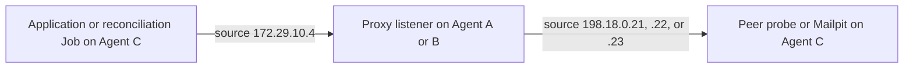

# Fleet Validation Decisions

Prepared by [plan 19](../../.agents/plans/proxy-fleet/19-prepare-fleet-validation-decisions.md).
Repository evidence was checked at `dfbb2897c0a44b9428ea450eb1629f2b9282f210` on 2026-09-18.

## Selected Model and Evidence Status

The owner selected a self-contained Kubernetes integration lab on 2026-09-18. Use k3d to create one K3s server
and three agent nodes on an explicitly selected Docker engine. Run the application, its dependencies, the proxy
fleet, reconciliation, and SMTP fixtures inside that cluster. The controller builds or imports images, manages
the cluster, and collects evidence. Application traffic stays inside the lab.

This selection supersedes the proposed Vagrant/Swarm fixture deployment and the temporary `sshuttle` tunnel through
`verifier-1`. The tunnel lifecycle is removed because application and reconciliation processes now originate
inside the cluster. Vagrant, SSH staging, Swarm joining, and WireGuard provisioning are not steps in this workflow.
The existing implementations remain in the repository for their separate deployment target.

This document records a design and proposed lifecycle. It adds no Kubernetes manifests, network bootstrap tool,
application bundle, or reconciler adapter. No cluster, fixture, or application scenario has run. Creating the k3d
cluster alone does not supply the application or the required network configuration.

### Relationship to the Existing Validation Plan

[Plan 16](../../.agents/plans/proxy-fleet/16-validate-disposable-multi-node-fleet.md), tracked by issue #424, currently
requires a four-VM Vagrant lab and proof of the existing Ansible, WireGuard, and Swarm implementation. Kubernetes
results cannot satisfy those infrastructure criteria. Before runtime implementation, revise that plan and its
road map to the selected Kubernetes scope or create a separate Kubernetes ExecPlan with explicit dependencies.
Do not mark the old infrastructure checks passed or close #424 on the strength of this document.

Plan 19 and issue #619 deliver this documentation handoff. The current change updates this document, plan 19, and the documentation spelling dictionary. The later Kubernetes implementation must retain the application and proxy behavior below while defining
its own deployment, recovery, and cleanup evidence. It is an architecture change, not a Vagrant provider switch.

## Cluster Topology

Each k3d node is a Docker container with its own network namespace. The four nodes share one host and kernel;
they provide separate Kubernetes scheduling targets, not independent machines or host-failure domains.

| Node | Role label | Proposed workloads |
| --- | --- | --- |
| One server | Control plane | K3s control plane and cluster services; no application or proxy placement. |
| Agent A | `lef.lab.role=proxy-a` | One proxy pod with two listeners and two egress identities. |
| Agent B | `lef.lab.role=proxy-b` | One proxy pod with one listener and one egress identity. |
| Agent C | `lef.lab.role=application` | API, verification workers, reconciliation Jobs, Mailpit or peer probe, web, and dependencies. |

Use explicit node selectors for these workloads. The API processes that open SMTP connections, verification
workers, reconciliation Jobs, proxies, and SMTP fixtures use `hostNetwork: true`. Here the host network is the
owning k3d node container's network namespace. Keep k3d itself on its dedicated Docker bridge; do not use
`k3d --network host`. Use `dnsPolicy: ClusterFirstWithHostNet` for these pods.

The web service, PostgreSQL, Redis, Keycloak and its database, and Garage can use ordinary pod networking and
ClusterIP Services. These dependencies remain inside the same cluster. Budget Agent C for the complete stack;
the old verifier VM's one-CPU/two-gigabyte sizing is not a requirement for this design.

Use one replica and a `Recreate` strategy for fixed-port proxy and fixture Deployments. Allocate distinct process
ports for application workers sharing Agent C; multiple HTTP listeners cannot bind its same port. Replication for
capacity tests must use separate worker processes with separate port bindings. Do not let default rolling updates
start competing listeners. Host-network pods on Agent C share localhost, so a loopback fixture endpoint is private
to that node, not isolated from its other trusted lab workloads.

## Source Map and Reuse Boundary

All paths below are relative to the repository root.

| Existing component | Source | Reuse or adaptation |
| --- | --- | --- |
| Fleet proxy image | `docker/proxy-fleet/Dockerfile`, `docker/proxy-fleet/render-config.sh`, `docker/proxy-fleet/entrypoint.sh` | Reuse the image, authenticated CONNECT behavior, listener manifests, and source binding. |
| Fleet topology types | `scripts/proxy-fleet-swarm/inventory.ts` | Preserve endpoint, identity, credential, and capacity validation; the parser currently consumes Ansible inventory JSON. |
| Reconciliation engine | `scripts/proxy-fleet-swarm/reconcile.ts` | Reuse the desired-listener comparison, health-gated activation, draining, and unchanged-state behavior. |
| Reconciliation entry point | `scripts/proxy-fleet-swarm/reconcile-cli.ts` | Currently executes `ansible-inventory` and reads per-node credential files; it is not a ready Kubernetes Job entry point. |
| Registry and authentication adapters | `scripts/proxy-fleet-swarm/proxy-registry-admin.ts`, `scripts/proxy-fleet-swarm/m2m-token-provider.ts` | Reuse the real API and OIDC authentication. |
| Peer observation | `scripts/proxy-fleet-swarm/listener-health-check.ts`, `scripts/proxy-fleet-swarm/smtp-peer-probe.ts`, `scripts/proxy-fleet-swarm/smtp-peer-probe-cli.ts` | Reuse sequential authenticated source checks and `/last-peer`. |
| Application and dependencies | `docker/compose.yaml`, `docker/infra.yaml`, `docker/apps.compose.yaml`, `docker/Dockerfile` | Source contracts for application configuration and dependencies; Kubernetes packaging remains to implement. |
| SMTP and DNS fixtures | `docker/compose.smtp-dev.yaml`, `docker/smtp-dev/coredns/`, `docker/smtp-dev/tls/` | Reuse the test domain and CA; render lab addresses and add reverse DNS. |
| Existing lab addressing | `deploy/proxy-fleet/vagrant/provision/guest-network.sh` | Reference for owned aliases and return routes; its systemd and guest lifecycle are not portable to k3d. |
| Existing deployment backend | `scripts/proxy-fleet-swarm/stack-renderer.ts`, `scripts/proxy-fleet-swarm/deploy-cli.ts`, `deploy/proxy-fleet/ansible/` | Swarm and host provisioning remain separate; Kubernetes needs its own deployment resources. |

Keep the reconciliation engine independent of Kubernetes. Add a small input adapter for a generated, validated
lab topology and mounted credentials, then package the existing engine and HTTP adapters into a one-pass Job.
Do not make the registry repository manage Kubernetes or perform SMTP checks. Reconciliation still owns registry
state; Kubernetes owns pod deployment. Secrets and topology must come from the same generated lab inputs so that
proxy configuration and registration cannot drift.

## Listener and Egress Network

Preserve the original registered endpoints and three distinct source identities. Assign these addresses as `/32`
aliases to `lo` inside the corresponding node containers; the Docker bridge addresses remain separate.

| Owner | Listener or fixture alias | Registered proxy endpoints | Egress aliases |
| --- | --- | --- | --- |
| Agent A | `172.29.10.2` | `172.29.10.2:13001`, `172.29.10.2:13002` | `198.18.0.21`, `198.18.0.22` |
| Agent B | `172.29.10.3` | `172.29.10.3:13001` | `198.18.0.23` |
| Agent C | `172.29.10.4` | SMTP fixture at `172.29.10.4:2525` | None; client connections to proxies originate from `.4`. |

The proxy image checks that every configured bind and egress address exists in its network namespace. Keep
`LEF_ASSIGNED_ADDRESSES` unset: that override belongs to tests and must not bypass real address validation.
The three `198.18.0.*` addresses are synthetic lab identities, not public Internet addresses.

### Bootstrap and Return Routes

The future network bootstrap must discover each node's actual address on the dedicated k3d bridge and verify
cluster ownership before adding aliases, routes, or firewall rules. Call those addresses `A_BRIDGE_IP`,
`B_BRIDGE_IP`, and `C_BRIDGE_IP`; they are discovered values, not fixed addresses copied from another run.

| Node namespace | Destination | Next hop | Preferred source where required |
| --- | --- | --- | --- |
| Agent C | `172.29.10.2/32` | `A_BRIDGE_IP` | `172.29.10.4` |
| Agent C | `172.29.10.3/32` | `B_BRIDGE_IP` | `172.29.10.4` |
| Both proxy agents | `172.29.10.4/32` | `C_BRIDGE_IP` | Each proxy socket explicitly binds its configured egress alias. |
| Agent C | `198.18.0.21/32`, `198.18.0.22/32` | `A_BRIDGE_IP` | Return path to proxy node A |
| Agent C | `198.18.0.23/32` | `B_BRIDGE_IP` | Return path to proxy node B |

This keeps the measured proxy and SMTP path on direct node routes. Do not put these listeners or SMTP destinations
behind a shared Service address, ingress, NodePort, or load balancer. Services remain appropriate for application
dependencies. The application still dials the registered listener; the proxy still connects to `smtp.lef.test`,
which resolves to `172.29.10.4`.

Run bootstrap with network-administration capability only inside the owned node namespaces. Use pinned tooling
that provides `iproute2` and the tested firewall backend; do not assume the K3s image contains every needed command.
Ordinary proxy, application, and fixture containers do not need `NET_ADMIN` or a mounted Docker socket. Apply only
owned addresses, exact routes, and scoped firewall rules; never flush a node's tables or change host-wide routes.

Bootstrap must finish before traffic-producing workloads start. Validate routes with `ip route get`, including
source selection from Agent C, and validate addresses from the actual proxy pod namespaces. Discover and reapply
the topology after node restart or recreation. Pause the scenario when node identity or routes change; a stale
success marker cannot make a replacement node ready. Node recovery must restore policy and source checks before
application traffic resumes. One-shot address commands without this lifecycle are insufficient.

For a planned node replacement, retain the retired container ID and verify that its process has stopped. Verify
the replacement against the recorded Docker engine, cluster network and UID, expected role, and run labels before
recording its new container ID and bridge address. Preserve the replacement history, regenerate the affected
routes, and repeat bootstrap and source checks. An unexpected replacement stops the run; do not adopt it by name.
During cleanup, check the current owned inventory and confirm that every retired container ID is absent.

### Source Access and Privacy

The expected path is:



The Kubernetes implementation must enforce and test both host-network access rules:

- Proxy listener ports admit `172.29.10.4/32` with valid per-listener credentials. The rendered 3proxy allow list
  and node firewall must agree. A different node or ordinary pod source must be denied.
- SMTP port `2525` on Agent C admits only the three declared egress addresses. Status and UI bind only to
  `127.0.0.1`; access from other nodes or ordinary pods must fail.

Use owned node-local firewall chains for these host-network paths. Standard NetworkPolicy behavior for
`hostNetwork` pods depends on the network implementation, so a policy object alone is not proof of enforcement.
Preserve K3s and Docker rules and verify negative access tests. The implementation must also demonstrate that
Docker or Kubernetes does not translate these measured source addresses. A successful TCP connection alone is
insufficient; `/last-peer` must report each exact configured egress identity.

## Application, DNS, and Credentials

Self-contained means the test application and required dependencies run in this cluster. The scenario must not
borrow a host development API, database, Redis instance, Keycloak realm, or external SMTP server. Image downloads
and controller-side builds are preparation, so this is not an offline-installation promise.

Package the API and the actual verification workers from the repository, plus web, PostgreSQL, Redis, Keycloak
and its database, and Garage. Adapt the current Compose initialization and health contracts to Kubernetes readiness and
initialization Jobs. Build from a recorded source revision, pin image digests, and make every image available to
the cluster before deployment. The Compose bind mounts and `TARGET_APP` settings do not establish a ready worker
image; verify its actual command, build output, and required environment explicitly.

Seed a disposable organization, domain, credits, and authorization. Use the existing stub payment provider.
Provision a lab-only M2M client with `platform:admin` for reconciliation, and mount its credential JSON as a Secret.
Other application credentials retain their existing file-based configuration contracts. Use
`TYPEORM_SYNCHRONIZE=true` only against the disposable databases. Reset incompatible data by deleting and reseeding
the lab's owned storage; this work introduces no migrations.

Use a consistent OIDC issuer that resolves for in-cluster clients and, when browser login is exercised, for the
browser through the selected local access path. Internal `OIDC_BACKCHANNEL_URL` and JWKS addresses must not become a different
trusted issuer. Finalize that hostname, local forwarding, and Keycloak/BFF configuration before browser acceptance.
The Kubernetes implementation owns the seed and access procedures; no fixed secret or existing development realm
is assumed here.

Provide these DNS records through the dedicated cluster's DNS configuration:

- `lef.test` has MX `smtp.lef.test`; `smtp.lef.test` resolves to `172.29.10.4`.
- The `PTR` records for `172.29.10.2` and `172.29.10.3` return `proxy-a.lef.test` and `proxy-b.lef.test`, with matching
  forward records. The application derives its EHLO name and sender domain from the allocated proxy host.
- Preserve Kubernetes service discovery and normal upstream resolution. Do not copy the Compose-specific
  `127.0.0.11` DNS forwarding address into the Kubernetes configuration.

Prove MX, A, and reverse DNS resolution from application and proxy pods. Mount the existing test CA through
`SMTP_TLS_CA_FILE`, set `SMTP_PORT=2525`, and retain certificate verification. The fixture certificate covers
`smtp.lef.test`. Scope DNS and SMTP cache resets to this disposable environment and use fresh control evidence;
changing only a recipient's local part can reuse an old domain catch-all result.

## Proposed Cluster Lifecycle

The commands below are proposals for the later Kubernetes implementation. They have not created a cluster.
Run the controller commands from the repository root. Installation, exact image selection, network bootstrap,
resource manifests, seed Jobs, and the test runner must be supplied before executing the complete workflow.

### Prepare the Lab Settings

This preparation chooses the Docker engine, names the lab, and creates a private directory for its records.
Run every step below in the same dedicated Bash session, from the repository root. Cluster creation comes afterward.

Record the versions of k3d, Docker, kubectl, and `jq`. The command syntax was checked with k3d `v5.9.0`.
Before continuing, check CPU, memory, disk capacity, and port availability. The Docker bridge, Kubernetes pod and
Service networks, host/VPN routes, `172.29.10.0/28`, and `198.18.0.0/24` must not overlap.

#### 1. Choose and Check the Inputs

Set these five shell variables before running the commands. The examples illustrate the format; the Docker socket,
subnet, port, and image must be checked for the machine that will run the lab.

| Variable | What it controls | Example or required format |
| --- | --- | --- |
| `LEF_RUN_ID` | Unique name for this run | `test01`; 1–20 lowercase letters or digits. |
| `LEF_DOCKER_HOST` | Local Docker engine to use | `unix:///var/run/docker.sock`, after verifying that socket. |
| `LEF_K3S_IMAGE` | Exact K3s image for the nodes | A verified image reference ending in `@sha256:` and 64 hexadecimal digits. |
| `LEF_BRIDGE_CIDR` | Docker network connecting the nodes | `172.30.0.0/24`, only if it does not overlap the networks above. |
| `LEF_API_PORT` | Local port for the Kubernetes API | `16443`, only if it is available. |

The first two commands stop the procedure on errors and make new files private. Each `${VARIABLE:?message}` check
prints its message and stops if the variable is missing or empty.

```bash
set -euo pipefail
umask 077

: "${LEF_RUN_ID:?Set a fresh lab run ID}"
: "${LEF_DOCKER_HOST:?Set the explicit local Docker socket}"
: "${LEF_K3S_IMAGE:?Set a verified K3s image with its digest}"
: "${LEF_BRIDGE_CIDR:?Set a checked, nonoverlapping bridge subnet}"
: "${LEF_API_PORT:?Set an available local API port}"

# Check the name and image-reference formats from the table.
if [[ ! "$LEF_RUN_ID" =~ ^[a-z0-9]{1,20}$ ]]; then
  printf '%s\n' 'Use 1-20 lowercase letters or digits for LEF_RUN_ID.' >&2
  exit 1
fi
if [[ ! "$LEF_K3S_IMAGE" =~ ^[a-zA-Z0-9./:_-]+@sha256:[a-f0-9]{64}$ ]]; then
  printf '%s\n' 'LEF_K3S_IMAGE must include a SHA-256 image digest.' >&2
  exit 1
fi
if [[ "$LEF_DOCKER_HOST" != unix:///* ]]; then
  printf '%s\n' 'LEF_DOCKER_HOST must point to a local Docker socket: unix:///...' >&2
  exit 1
fi

# Make the YAML template inputs available to k3d.
export LEF_RUN_ID LEF_K3S_IMAGE LEF_BRIDGE_CIDR LEF_API_PORT
```

These checks validate presence and format. They do not verify image provenance, subnet availability, or port
availability; complete those checks before proceeding.

#### 2. Name the Lab and Create Its Private Directory

Derive the cluster name and Kubernetes context from the run ID. The namespace holds application resources.
The temporary directory holds the configuration, kubeconfig, credentials, and cleanup records outside Git.

```bash
export LEF_CLUSTER="lef-lab-$LEF_RUN_ID"
export LEF_CONTEXT="k3d-$LEF_CLUSTER"
export LEF_NAMESPACE=lef-lab

LEF_RUN_DIR=$(mktemp -d /tmp/lef-k3d.XXXXXXXX)
export LEF_RUN_DIR
```

Keep directory creation separate from `export` so a failed `mktemp` command stops the procedure.

#### 3. Select the Docker Engine

Tell k3d which Docker socket to use. Clear inherited context and TLS settings so they cannot override that choice.

```bash
export DOCKER_HOST="$LEF_DOCKER_HOST"
unset DOCKER_CONTEXT DOCKER_TLS_VERIFY DOCKER_CERT_PATH
```

#### 4. Record the Engine and Check the Cluster Name

Save the Docker engine's ID so later commands can confirm they still target the same engine. Save the current
cluster list, then stop if the proposed cluster name is already in use. A failed query also stops the procedure.

```bash
LEF_DOCKER_ID=$(docker --host "$LEF_DOCKER_HOST" info --format '{{.ID}}')
test -n "$LEF_DOCKER_ID"
printf '%s\n' "$LEF_DOCKER_ID" > "$LEF_RUN_DIR/docker-id"

k3d cluster list --output json > "$LEF_RUN_DIR/clusters.before.json"

# Require every existing cluster to have a different name.
jq --exit-status --arg name "$LEF_CLUSTER" \
  'all(.[]; .name != $name)' "$LEF_RUN_DIR/clusters.before.json"
```

Before creation, also check for containers, networks, or volumes already claiming this cluster name or run label.
Stop if any exist; do not adopt an existing lab by name. Later changes must use the selected Docker engine and
match its recorded ID. This workflow uses no Swarm commands, even if that engine also hosts an unrelated Swarm.

### Create the Dedicated Cluster

Save this proposed configuration as `$LEF_RUN_DIR/k3d.yaml`. The k3d tool expands its environment variables. The later
implementation must validate the complete configuration against the schema for its pinned k3d version. K3s pod
and Service CIDRs must be recorded and checked for overlap; set explicit K3s overrides if the defaults conflict.

```yaml
apiVersion: k3d.io/v1alpha5
kind: Simple
metadata:
  name: ${LEF_CLUSTER}
servers: 1
agents: 3
image: ${LEF_K3S_IMAGE}
subnet: ${LEF_BRIDGE_CIDR}
kubeAPI:
  hostIP: '127.0.0.1'
  hostPort: '${LEF_API_PORT}'
options:
  k3d:
    wait: true
    timeout: 120s
  kubeconfig:
    updateDefaultKubeconfig: false
    switchCurrentContext: false
  k3s:
    extraArgs:
      - arg: '--disable=traefik'
        nodeFilters: ['server:*']
      - arg: '--disable=servicelb'
        nodeFilters: ['server:*']
    nodeLabels:
      - label: lef.lab.role=proxy-a
        nodeFilters: ['agent:0']
      - label: lef.lab.role=proxy-b
        nodeFilters: ['agent:1']
      - label: lef.lab.role=application
        nodeFilters: ['agent:2']
  runtime:
    labels:
      - label: lef.lab.run=${LEF_RUN_ID}
        nodeFilters: ['server:*', 'agent:*']
```

Create only the reserved cluster and write a dedicated kubeconfig without merging into the user's default file:

```bash
test "$(docker --host "$LEF_DOCKER_HOST" info --format '{{.ID}}')" = "$(cat "$LEF_RUN_DIR/docker-id")"
k3d cluster create --config "$LEF_RUN_DIR/k3d.yaml"
k3d kubeconfig get "$LEF_CLUSTER" > "$LEF_RUN_DIR/kubeconfig"
chmod 0600 "$LEF_RUN_DIR/kubeconfig"
export LEF_KUBECONFIG="$LEF_RUN_DIR/kubeconfig"
kubectl --kubeconfig "$LEF_KUBECONFIG" --context "$LEF_CONTEXT" \
  wait --for=condition=Ready nodes --all --timeout=120s
kubectl --kubeconfig "$LEF_KUBECONFIG" --context "$LEF_CONTEXT" \
  get nodes -o wide
```

Record the newly created node container IDs, cluster labels, bridge network ID and addresses, owned volumes, and
the `kube-system` namespace UID. Require exactly four Ready nodes and one node for each workload role. Save an
ownership marker only after matching those identities to the reserved run. Include the k3d load-balancer container
and image volume in the owned-resource inventory. Every Kubernetes mutation must use the dedicated kubeconfig
and context, verify the recorded cluster UID, and select `lef-lab` for namespaced application resources.

If creation fails or is interrupted before the marker exists, inspect only resources matching the reserved name
and creation record. Do not blindly rerun creation or delete a same-name cluster. Keep partial resource IDs for
scoped recovery; the absence of a success marker is not proof that creation left nothing behind.

### Bootstrap and Deploy

The later implementation must supply these artifacts; no commands for nonexistent wrappers are implied:

1. A versioned lab topology and node-network bootstrap implementing the address, route, firewall, and restart
   requirements above, with namespace identity checks and an explicit readiness gate.
2. Kubernetes resources for dependencies, DNS, application configuration, Secrets, storage, and initialization Jobs.
   Use only owned disposable storage, without controller source or data bind mounts.
3. Application and proxy Deployments, initially with verification producers paused, plus two fixture Deployments
   initially at zero replicas. The fixed role labels and image digests are required inputs.
4. A packaged reconciliation entry point that reads the generated topology and Secret files. The current
   `proxy-fleet:reconcile` command requires Ansible; simply copying it into a Job does not supply this adapter.
5. A scenario runner that sequences readiness, source checks, application tests, capacity assertions, and cleanup.

Deploy dependencies and seeds, then configure DNS and networking. Require bootstrap readiness before starting
host-network workloads. Check API, OIDC, database, Redis, object storage, and fixture health from the actual
application namespace. Start the proxies only when their aliases and policy exist. The first acceptance gate is
three successful source observations and negative access checks, before interpreting any application result.

## Fixture and Reconciliation Phases

The existing peer probe and Mailpit keep different responsibilities. Use pinned Node and Mailpit `v1.30.7` images,
compiled peer-probe JavaScript mounted as ConfigMaps or included in its image, and the test certificate and key as
read-only ConfigMap and Secret mounts. No Node or Mailpit installation is needed in the node container itself.

| Setting | Peer probe | Mailpit |
| --- | --- | --- |
| SMTP bind | `172.29.10.4:2525` | `172.29.10.4:2525` |
| Private HTTP bind | `127.0.0.1:9000` | `127.0.0.1:8025` |
| Purpose | Observe the most recent TCP peer | SMTP conversation and STARTTLS |
| Environment | `SMTP_PEER_PROBE_HOST`, `SMTP_PEER_PROBE_SMTP_PORT`, `SMTP_PEER_PROBE_STATUS_HOST`, `SMTP_PEER_PROBE_STATUS_PORT` | `MP_SMTP_BIND_ADDR`, `MP_UI_BIND_ADDR`, `MP_SMTP_TLS_CERT`, `MP_SMTP_TLS_KEY`, `MP_SMTP_REQUIRE_STARTTLS=true`, `MP_SMTP_DISABLE_RDNS=true` |

Give Mailpit a writable ephemeral database directory and set `MP_DATABASE` to its path. Disable its version check
with `MP_DISABLE_VERSION_CHECK=true`. Run fixture processes without network-administration capability. Readiness
must use HTTP status, not a TCP SMTP check that changes `/last-peer`. For a loopback HTTP endpoint, use an exec
probe inside the fixture container; Mailpit supports `/mailpit readyz --listen 127.0.0.1:8025`. An ordinary kubelet
HTTP probe defaults to the pod's node address and would miss this binding. Verify actual readiness commands against
the pinned images. Use `Recreate`, bounded termination, and explicit socket checks.

### Peer Phase

Start only the peer Deployment, with Mailpit at zero replicas. Wait for the pod on the application node. Verify the exact SMTP and HTTP bindings, then require a fresh
`/last-peer` baseline. Run exactly one reconciliation Job at a time, with
`parallelism: 1`, `completions: 1`, and an explicit deadline. A second Job can still overlap the first, so the runner
must enforce one writer for the entire phase and inspect or stop an interrupted Job before retrying it.

Use the real API adapter and lab M2M credentials. From Agent C, set the probe destination to `172.29.10.4:2525` and
the status URL to `http://127.0.0.1:9000/last-peer`. Check the three listeners sequentially, with no other client
using the fixture. Require observations `.21`, `.22`, and `.23` in the declared listener order. Inspect actions and
registry state: new healthy entries become active at their original endpoints. A completed Job or zero exit code
alone does not prove activation because unhealthy entries can remain disabled or draining.

Run a second completed reconciliation Job with unchanged inputs and health. It must perform no unnecessary
registry mutation. Reconciliation is a one-pass task; do not install a periodic `CronJob` while fixture phases share
port `2525`.

### Mailpit Phase and Recovery

After reconciliation finishes, scale the peer Deployment to zero. Wait for pod termination and closure of ports
`2525` and `9000` on the application node. Then start one Mailpit replica and check HTTP readiness. Require SMTP
on `.4:2525` and UI/API on loopback only. A `Recreate` strategy within one Deployment does not order two separate
Deployments; the runner must implement this stop, wait, then start sequence with bounded timeouts.

Run real application verification against Mailpit. Pause all reconciliation Jobs during this phase because
Mailpit does not implement `/last-peer`. Before returning to health, draining, or recovery checks, pause producers,
stop Mailpit, verify ports `2525` and `8025` are closed, and restart the peer phase with fresh evidence.

Operator access uses explicit `kubectl --kubeconfig ... --context ... --namespace lef-lab port-forward` commands
bound to `127.0.0.1`. Forward to the currently owned fixture pod for private status or UI, and to the web/API Service
for application access. These forwards are optional inspection paths; application-to-proxy traffic never depends
on them. Record process IDs and stop only this run's forwards. The implementation must test forwarding to the
loopback fixture bindings and specify the exact commands once manifests and resource names exist.

## Real Application and Capacity Evidence

The verifier performs EHLO, STARTTLS, MAIL FROM, RCPT TO, and QUIT without DATA, so an empty Mailpit inbox is expected.
Default recipient acceptance exercises SMTP and catch-all behavior. With account discovery disabled, expect
`catchAll=true` and `verificationQuality=inconclusive`; acceptance of the control recipient does not establish
that the target mailbox exists. Preserve the existing Node evidence fixture for precise classification tests.

Link a real verification result to a reconciled proxy endpoint and the corresponding fixture session. Run two
actual verification processes sharing the same disposable Redis limits. A deterministic synchronization barrier
in the validation harness must hold overlapping work long enough to inspect existing per-proxy and per-MX leases
and counters, then prove release on completion and failure. Mailpit message totals, simultaneous process startup,
and sequential `/last-peer` checks cannot establish that overlap. This harness remains implementation work.

Test loss and recovery of a proxy pod and a k3d agent: registry draining, pending work, restored aliases and routes,
reconciliation, and resumed verification must follow the defined lifecycle. This demonstrates container-node
recovery on one machine, not independent host availability or Internet SMTP deliverability.

## Cleanup, Interruption, and Repetition

Stop producers and reconciliation Jobs before cleanup. Drain owned registry entries while the disposable API and
network remain reachable. Stop both fixture Deployments and verify pod termination and socket closure. Collect
sanitized assertions, then remove owned application resources and storage. Close only this run's local forwards.

Kubernetes workloads continue after the controller terminal disconnects. A Job deadline limits that Job; it does
not expire the cluster, Deployments, databases, or local forwards. Retain the private run record until cleanup is
verified. Resume an interrupted run by checking identities and the actual active phase, not by repeating every
start command. Do not force-delete an unreachable pod and assume its process stopped; confirm node termination
or recover the node before changing fixture phase.

Before deleting the cluster, compare the recorded Docker daemon ID, node IDs and labels, bridge ID, and Kubernetes
cluster UID. Reject mismatches or unrelated attachments. For an owned, reachable cluster after scenario cleanup:

```bash
test "$(docker --host "$LEF_DOCKER_HOST" info --format '{{.ID}}')" = "$(cat "$LEF_RUN_DIR/docker-id")"
k3d cluster delete "$LEF_CLUSTER"
```

The identity and ownership checks described above are mandatory prerequisites to this illustrative deletion
command. If the Kubernetes API is unavailable, use the recorded Docker resource identities to establish ownership
before deleting the exact cluster. Do not delete another cluster to recover this one. Never run global Docker
pruning, Swarm reset, or host-wide firewall restoration.

Verify that every recorded node and load-balancer container, the dedicated bridge, and owned volumes are absent.
Deleting only the application namespace leaves node aliases, routes, and firewall rules behind; destroy the
cluster for a complete reset. A newly created run must rediscover node addresses, regenerate configuration and
Secrets, reseed disposable data, and repeat source checks. Do not reuse old leases, credentials, or kubeconfig.
Shared Docker image caches may remain and are not lab runtime state. Keep no shared storage or registry resources
that would require guessing ownership during deletion. Remove the private run directory only after confirming
cleanup and retaining sanitized evidence. Do not commit raw credentials, tokens, kubeconfig, SMTP envelopes,
recipient data, or unrelated Docker/Kubernetes inventory.

## Acceptance and Implementation Handoff

The Kubernetes implementation needs its own plan and these observable checks:

| Requirement | Passing evidence |
| --- | --- |
| Self-contained stack | Application, dependencies, reconciler, proxies, and fixtures run in the dedicated cluster; no host application service or tunnel is required. |
| Placement and source identity | Two proxy nodes, two listeners on A, one on B; sequential peer observations match all three egress addresses. |
| Worker access and privacy | `.4` with valid credentials can use each listener; other sources and invalid credentials are rejected; fixture HTTP ports remain private. |
| Registry synchronization | Missing healthy listeners activate, unchanged inputs cause no unnecessary mutation, and removed or unhealthy listeners drain as defined by the existing engine. |
| Real SMTP behavior | Application reaches Mailpit through a registered proxy with verified STARTTLS and the expected catch-all result. |
| Capacity and recovery | Overlapping verification respects Redis limits, releases leases after failure, and recovers after pod/node replacement with fresh network proof. |
| Repeatability and cleanup | A second clean run passes; interruption cleanup removes only owned cluster resources and preserves unrelated Docker/Kubernetes state. |

Before implementation, resolve the exact pinned tool/image set, resource budget, Kubernetes packaging, bootstrap
artifact contract, and browser issuer/access configuration. The selected architecture is settled; these are
implementation prerequisites. The current preparation remains documentation only. Existing Swarm, WireGuard,
Ubuntu host, Vagrant, and alternative-provider checks remain unverified by this Kubernetes design.

## Documentation Validation and References

Run Harper on this document and plan 19, the ExecPlan repository fixture, shell syntax checks, and static parsing
of the embedded k3d configuration. Validate against the pinned k3d schema when available. These checks do not
prove scheduling, source preservation, firewall enforcement, readiness, or application behavior. Bruno is not
applicable to this documentation change; the later implementation must assess coverage for its API workflows.

- [Cluster creation with k3d](https://k3d.io/stable/usage/commands/k3d_cluster_create/) and
  [configuration files](https://k3d.io/stable/usage/configfile/): node counts, labels, image selection, and kubeconfig isolation.
- [Networking in k3d](https://k3d.io/stable/design/networking/): dedicated Docker bridge and node-container boundaries.
- [Kubernetes pod API](https://kubernetes.io/docs/reference/kubernetes-api/core/pod-v1/): host networking, DNS policy, and placement.
- [Kubernetes NetworkPolicy](https://kubernetes.io/docs/concepts/services-networking/network-policies/): host-network limitations.
- [Kubernetes Jobs](https://kubernetes.io/docs/concepts/workloads/controllers/job/): one-pass execution and deadlines.
- [Kubernetes port forwarding](https://kubernetes.io/docs/reference/kubectl/generated/kubectl_port-forward/): private operator access.
- [K3s networking services](https://docs.k3s.io/networking/networking-services/): cluster DNS and packaged services.
- [Mailpit SMTP configuration](https://mailpit.axllent.org/docs/configuration/smtp/) and
  [pinned Mailpit source](https://github.com/axllent/mailpit/tree/v1.30.7): bindings, TLS, and readiness behavior.
